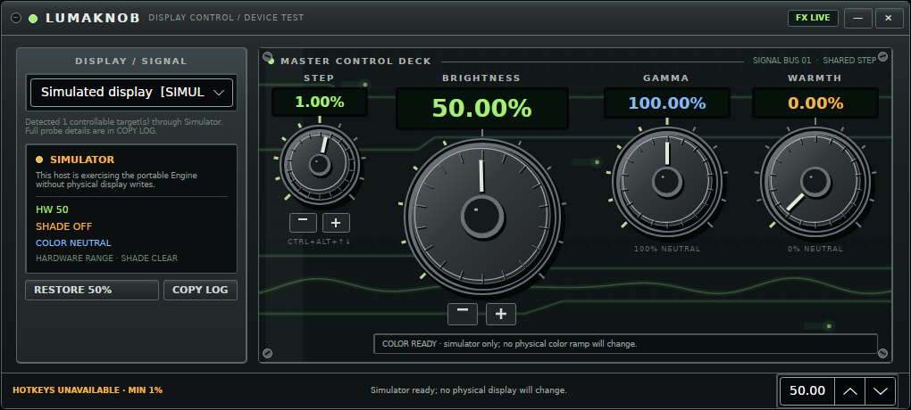

<p align="center">
  
</p>

<h1 align="center">LumaKnob</h1>

<p align="center">
  Precision Windows display control below the hardware floor—wrapped in an
  original early-2000s equipment interface.
</p>

<p align="center">
  <a href="https://github.com/Humancannonball/LumaKnob/actions/workflows/ci.yml"></a>
  <a href="https://github.com/Humancannonball/LumaKnob/releases"></a>
  <a href="LICENSE"></a>
  
  
</p>

<p align="center">
  <a href="https://github.com/Humancannonball/LumaKnob/releases"><strong>Download the Windows alpha</strong></a>
  ·
  <a href="#how-it-works">How it works</a>
  ·
  <a href="CONTRIBUTING.md">Contribute</a>
</p>



> [!CAUTION]
> LumaKnob is an unsigned, supervised alpha. It controls real monitor hardware
> and can make a software shade fully opaque. Read the recovery instructions
> below before testing 0% brightness. Do not disable SmartScreen or other
> Windows security controls to run it.

## Why LumaKnob

Windows and monitor controls often stop while a screen is still painfully
bright, and their fixed increments are too coarse in darkness. LumaKnob treats
brightness as a continuous logical range and chooses the best available method
for each display:

- **WMI** for supported integrated laptop panels;
- **DDC/CI** for capable external monitors;
- a click-through **software shade** below the hardware floor or when hardware
  control is unavailable;
- experimental, reversible **gamma and warmth** controls for SDR displays.

The main brightness knob is paired with a smaller shared **STEP** knob. STEP can
be anywhere from 0.01% to 25%, and it controls dial, wheel, keyboard, gamma, and
warmth increments without snapping the current values.

## Highlights

- One independent brightness knob and compact slider for every monitor.
- Seamless hardware-plus-shade dimming down to logical 0.00%.
- Adjustable 1–2–5-style step progression from 0.01% to 25%.
- Notification-area process with quick controls, Restore, Control Deck, and
  explicit Exit.
- Standard laptop brightness buttons use the selected STEP while LumaKnob is
  running—even when its window is hidden.
- Natural circular knob dragging, mouse wheel, keyboard, and accessibility
  input.
- Experimental gamma and warmth that preserve and restore the captured Windows
  color ramp; HDR targets are locked for safety.
- Four validated appearance presets plus throttled, pausable background motion.
- Local-only diagnostics: no account, telemetry, cloud service, administrator
  rights, driver, or Windows service.

## Download and run

1. Open [Releases](https://github.com/Humancannonball/LumaKnob/releases) and
   download `LumaKnob-win-x64.zip` plus `SHA256SUMS.txt`.
2. Verify the download in PowerShell:

   ```powershell
   Get-FileHash .\LumaKnob-win-x64.zip -Algorithm SHA256
   Get-Content .\SHA256SUMS.txt
   ```

3. Extract the ZIP and run `LumaKnob.exe` as a normal user.

The portable executable is self-contained; .NET does not need to be installed.
The current compressed build is approximately 46 MiB. There is no installer or
automatic startup entry yet.

### Recovery comes first

- Press **Ctrl+Alt+Home** to remove every shade, restore captured color ramps,
  and request 50% hardware brightness.
- Or right-click the tray icon and choose **Exit LumaKnob**.
- If ordinary windows are no longer visible, **Ctrl+Alt+Delete** opens the
  undimmed secure desktop, where you can sign out.

Closing the deck normally hides it in the notification area. Use the tray's
explicit Exit command when you want LumaKnob to restore software state and stop.

## How it works

Each display has a provisional 10% hardware/shade pivot. Above it, LumaKnob
maps logical brightness onto the monitor's usable hardware range. Below it, the
hardware stays at a safe low value and the shade supplies the remaining
dimming. Hardware writes are asynchronous, serialized, and last-value-wins so
dragging a dial does not flood a slow DDC/CI monitor.

```text
logical brightness request
          │
          ▼
  pure hybrid policy
     ├── WMI hardware ───── integrated panel
     ├── DDC/CI hardware ── external display
     └── shade opacity ───── continuous below-floor range / fallback
```

LumaKnob reports the mechanism used for the latest request instead of claiming
that every display supports the same backend.

## Compatibility and limitations

| Path | Current behavior |
| --- | --- |
| Windows 11 x64 | Primary alpha target |
| Integrated panel | WMI when the OEM/driver exposes brightness classes |
| External monitor | DDC/CI when enabled in the monitor and supported by the connection |
| Hardware unsupported | Per-display software shade |
| HDR | Brightness/shade requires device testing; gamma and warmth are locked |
| Secure desktop, protected video, exclusive fullscreen | A normal shade may not cover these surfaces |
| Remote Desktop | Not a supported device-test environment |

DDC/CI behavior varies widely by monitor, dock, adapter, and cable. A successful
API response is not treated as proof of visual correctness. See the full
[device-test protocol](PROJECT.md#18-hands-on-windows-device-test-protocol) and
[known release blockers](CODE_REVIEW.md#remaining-release-blockers).

## Appearance presets

Preview a bundled preset without installing anything:

```powershell
.\LumaKnob.exe --appearance=presets\amber-rack.json
.\LumaKnob.exe --appearance=presets\cryo-console.json --no-motion
```

Copy a preset to `%LocalAppData%\LumaKnob\appearance.json` to make it the
default. The schema accepts only known color and geometry keys; arbitrary XAML
or executable theme code is never loaded. See [the preset format](presets/README.md).

## Architecture

The brightness model and coordinator do not depend on Avalonia or Windows APIs.
The Windows host and safe simulator compose those portable layers with separate
platform adapters.

```text
LumaKnob.Host.Windows
    ├── LumaKnob.App ───────── Avalonia views, tray, presets
    ├── LumaKnob.Windows ───── WMI, DDC/CI, DisplayConfig, GDI, Raw Input
    └── LumaKnob.Engine ────── sessions, coalescing, recovery, events
            └── LumaKnob.Core ─ values, steps, pure hybrid policy

LumaKnob.Host.Simulator ────── same App + Engine, fake displays only
```

This boundary is intended to support a later Linux adapter and headless host
without forking brightness policy or the UI.

## Build and test

Install the [.NET 10 SDK](https://dotnet.microsoft.com/download/dotnet/10.0),
then run the safe simulator on Windows or Linux:

```shell
dotnet restore LumaKnob.slnx
dotnet build LumaKnob.slnx --configuration Release
dotnet test LumaKnob.slnx --configuration Release --no-build
dotnet run --project src/LumaKnob.Host.Simulator --configuration Release
```

On Windows, after reading the device-test protocol:

```powershell
dotnet run --project src/LumaKnob.Host.Windows --configuration Release
.\scripts\publish-win-x64.ps1
```

The publish script creates a compressed, self-contained Windows x64 ZIP,
copies required dependency notices, writes a SHA-256 checksum, and fails if the
EXE grows beyond 60 MB. CI builds and tests the solution on both Windows and
Linux; tagged releases are rebuilt on GitHub's Windows runner.

## Project status

Completed foundations:

- [x] WMI, DDC/CI, shade, display naming, and multi-monitor coordination
- [x] Adjustable STEP, per-monitor controls, tray flyout, and physical keys
- [x] Reversible experimental gamma/warmth and HDR guard
- [x] Portable Engine/UI boundary, simulator, presets, CI, and release packaging

Before a general-audience release:

- [ ] Versioned functional settings and clean-shutdown recovery
- [ ] Hot-plug, sleep/resume, unlock, and startup integration
- [ ] Broader monitor, GPU, HDR, accessibility, DPI, and Windows Arm64 testing
- [ ] Code signing, MSIX/Store identity, SBOM, and clean uninstall validation

The detailed product contract and roadmap live in [PROJECT.md](PROJECT.md). The
latest pre-publication audit is in [CODE_REVIEW.md](CODE_REVIEW.md).

## Contributing and support

Focused issues and pull requests are welcome. Start with
[CONTRIBUTING.md](CONTRIBUTING.md), use the safe simulator for UI/Engine work,
and sign commits with the Developer Certificate of Origin. Hardware reports
should use the device-test issue form and must not include EDID serial numbers.

- [Report a bug](https://github.com/Humancannonball/LumaKnob/issues/new?template=bug-report.yml)
- [Share a device result](https://github.com/Humancannonball/LumaKnob/issues/new?template=device-report.yml)
- [Request a feature](https://github.com/Humancannonball/LumaKnob/issues/new?template=feature-request.yml)
- [Security policy](SECURITY.md) · [Support guide](SUPPORT.md)

## License and acknowledgements

Original code and artwork are released under the [MIT License](LICENSE).
Dependencies retain their licenses and notices in
[THIRD_PARTY_NOTICES.md](THIRD_PARTY_NOTICES.md). LumaKnob uses
[Avalonia](https://github.com/AvaloniaUI/Avalonia) and reviewed the open-source
[Twinkle Tray](https://github.com/xanderfrangos/twinkle-tray) project as a
Windows display-control reference; no Twinkle Tray source or artwork is bundled.

Built by [Mark Mikula](https://github.com/Humancannonball).
